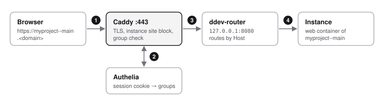

# How Fleet works

**The technical big picture of ddev-fleet 1.x, in about ten minutes**

Last updated 2026-11-16 · Product repo root (Symfony app in `app/`)

A styled version of this page: [ARCHITECTURE.html](ARCHITECTURE.html) (open it in a browser).

> **About this page:** a technical tour of Fleet 1.x for developers joining the project, written from the code on the product's `develop` branch (the latest `v1.*` tag is listed in `CHANGELOG.md`). Product scope is in [README.md](README.md) and [docs/concepts.md](docs/concepts.md); this page covers how the thing is built. When it and the code disagree, the code wins. The product's own docs are in [docs/](docs/README.md).

Fleet runs many DDEV projects side by side on one Linux server. You register git repositories as projects, describe recipes as templates, and Fleet clones, configures, starts and removes instances. Each instance is a full DDEV project at `https://<project>--<label>.<domain>`, behind a login.

The core idea: **Fleet itself is not a container.** It is a Symfony application installed natively on a bare-metal (or VM) Debian host, supervised by systemd, and it drives DDEV and Docker from the outside. If an instance or Docker itself misbehaves, the manager is still standing and can repair it. Each host is independent; there is no central control plane. What Fleet is for and who uses it is in [README.md](README.md) and [docs/concepts.md](docs/concepts.md).

An earlier Python 0.x line (FastAPI, a `fleet.yml` registry) is frozen on the `legacy` branch. Nothing below describes it.

**Contents**

1. [Runtime architecture on a host](#runtime-architecture-on-a-host)
2. [The stack](#the-stack)
3. [Domain model](#domain-model)
4. [Jobs, the queue and the worker](#jobs-the-queue-and-the-worker)
5. [Web UI and front-end components](#web-ui-and-front-end-components)
6. [CLI and API](#cli-and-api)
7. [Scheduling](#scheduling)
8. [Webhooks and instance-side hooks](#webhooks-and-instance-side-hooks)
9. [Install, upgrade and CI](#install-upgrade-and-ci)
10. [Where to look in the code](#where-to-look-in-the-code)
11. [Glossary](#glossary)

## Runtime architecture on a host

A Fleet host runs a handful of systemd services and one Docker daemon. Only Caddy listens on the Internet. Everything else is bound to loopback or a Unix socket.

*Solid boxes are host processes (systemd units); the dashed band is Docker. The web request never runs `ddev` or `git`: it writes rows and queues a job, and the worker does the work.*

### The processes

| Unit | What it does |
|---|---|
| `caddy` | Terminates TLS (one certificate per hostname with HTTP-01, or one wildcard with OVH DNS-01), strips any inbound `Remote-*` header, asks Authelia, then serves the app or proxies to an instance. Its configuration is generated by Fleet. |
| `authelia` | The login portal at `auth.<domain>`. Fleet writes its user file from the database. |
| `php8.4-fpm` | One pool, `fleet`, running the Symfony app: the UI, the token API, the webhook receiver. |
| `fleet-worker@1` | The single Messenger consumer of the `jobs` transport. Exactly one: the SQLite queue takes one consumer. |
| `fleet-scheduler` | Consumes the Symfony Scheduler transport `scheduler_default`: a tick every 30 seconds that fires due schedules. |
| `fleet-status` | `fleet:instance:watch`: keeps instance states true to the host (`ddev list`, `docker stats`), reaps dead jobs, prunes old ones, samples slice CPU use. |
| `fleet-mercure` | The Mercure hub on loopback, published by Caddy at `/.well-known/mercure`. |
| `fleet-tmux` | Owns the persistent `fleet` tmux session: one window per instance. |
| `fleet-isolation-watch` | Listens to Docker events and re-applies the network isolation rules between instances. |
| `fleet-boot` | Oneshot after a reboot: starts the instances one at a time. |
| timers | `fleet-backup` (daily database backup), `fleet-tls-check` (every 10 minutes), `fleet-upgrade-check` (daily). |

### SQLite is the source of truth

There is no registry file. Projects, templates, instances, users, jobs, webhooks, schedules and host settings are Doctrine entities in `var/fleet.sqlite`. The Messenger queue lives in a second file, `var/queue.sqlite`, on its own DBAL connection, so queue traffic never blocks the application database. Everything else the app persists is a file under `FLEET_HOME`, and `App\Fleet\FleetPaths` is the only class that knows the layout.

| Path under `/srv/fleet` | Holds |
|---|---|
| `var/` | The two SQLite databases. |
| `instances/<id>/` | One git checkout per instance, a complete DDEV project. |
| `assets/<project>/` | Files seeded into each new instance (database dumps, `.env`, settings). |
| `logs/` | One append-only log file per job. |
| `locks/`, `slots/` | `flock` files: the per-instance job lock, and the capacity slots. |
| `keys/`, `ssh/` | The key that encrypts stored secrets; the deploy and push SSH keys. |
| `backups/`, `staging/`, `uploads/` | Database backups; rendered config waiting for the root helper; upload chunks. |

The app runs as the unprivileged `fleet` user. When it must change root-owned configuration (the Caddy and Authelia files, the systemd slices), it renders the file from a Twig template in `app/templates/system/`, stages it, and calls one root helper, `/usr/local/libexec/fleet/apply`, through a single sudoers line. Generated files are always rebuilt from the database, never edited by hand.

### The request path to an instance

1. **TLS at Caddy.** The instance hostname matches a site block that Fleet wrote when the instance was deployed. The block exists before the DDEV project starts, so a site is never reachable without its gate.
2. **Authentication.** Caddy's `forward_auth` asks Authelia. No session means a redirect to `auth.<domain>`. With one, Authelia returns the user's groups; the site block answers 403 unless they match the instance's project.
3. **Plain HTTP on loopback.** Caddy proxies to DDEV's shared router, which does no TLS here.
4. **Host routing.** The router picks the instance's web container by the `Host` header.

Requests for the Fleet UI itself take the same first two steps, then go to php-fpm. The app keeps no login session: it trusts the `Remote-User` and `Remote-Groups` headers Authelia set, and only when the request proves it came through the local Caddy (a shared secret passed as a FastCGI parameter; see `App\Security\RemoteUserAuthenticator`). Three paths skip the gate and authenticate themselves: `/health`, `/hooks/*` (HMAC signature) and `/api/v1/*` (bearer token).

## The stack

| | |
|---|---|
| **Language, framework** | PHP 8.4, Symfony 8.1 (`app/`). Strict types everywhere; PHPStan level 8 and PHP-CS-Fixer are merge gates. |
| **Persistence** | Doctrine ORM 3 on SQLite, attribute mapping in `src/Domain`, schema changes only through migrations in `app/migrations/`. |
| **Background work** | Symfony Messenger (Doctrine transport), Symfony Scheduler for the tick, Symfony Lock with the `flock` store, Symfony Process for host commands. |
| **Templates** | Twig, with Twig Components for the UI primitives and one Live Component. |
| **Front-end** | Symfony UX: Turbo 8, Stimulus 3, UX Icons (Lucide), and the UX Toolkit shadcn kit as the source of the component recipes. |
| **CSS and assets** | Tailwind v4 through `symfonycasts/tailwind-bundle` (a standalone binary) and AssetMapper with an import map. No Node, no bundler, no JavaScript build step. |
| **Live updates** | Mercure (Server-Sent Events) through `symfony/mercure-bundle`. |
| **Around the app** | Caddy, Authelia, DDEV, Docker, systemd, tmux. Ansible for the installer. |
| **Tests** | PHPUnit (`app/tests`: Unit, Integration, Functional, Repo), Playwright in TypeScript (`tests/playwright`, desktop and phone, with accessibility checks), pytest for the CI tooling (`tests/pytest`). |

## Domain model

Entities and their repositories live in `app/src/Domain/<Area>/`. This is how the pieces relate.

| Concept | What it is |
|---|---|
| **Project** | A git remote plus defaults: default branch and template, an issue-id pattern, named ports, members, a CPU allotment and slots. Its name is permanent because it is part of every instance id. |
| **Template** | A named recipe inside a project: post-deploy commands, the `tty1` and `tty2` terminal commands, a Drupal environment, whether it has a database, and an optional allotment and slots of its own. |
| **Instance** | One deployed checkout. Id `<project>--<label>` (the label usually comes from the branch or ticket), which is also the DDEV project name and the hostname prefix. States: `deploying`, `running`, `stopped`, `failed`, `destroying`, `unknown`. |
| **Job** | One queued action on an instance, with a type, a trigger (`ui`, `cli`, `api`, `webhook`, `schedule`), a requester and a status. |
| **Assets and secrets** | Assets are per-project files copied into every new checkout. Secrets are stored encrypted and referenced as `[[token]]` placeholders in asset files and commands; they are masked in job logs. |
| **Users** | Administrators, project members and site-only users. Fleet stores them, renders Authelia's user file from them, and Caddy enforces instance access by group. |
| **Host settings** | One row for the host: domain, TLS mode, job concurrency, CPU reserve, instance cap, retention values. |
| **Webhooks, schedules** | Endpoints with rules and a delivery log; schedules with a run history. Both only ever queue ordinary jobs. |

### Capacity

Capacity protects the host from one noisy project. Three numbers, all stored per host:

- **Allotment:** CPU threads shared by all instances of a project or template. It is a ceiling, enforced by a systemd slice (`fleet.slice` > `fleet-<project>.slice` > `fleet-<project>-<template>.slice`). At deploy, Fleet writes a compose override that puts every container of the instance under its slice.
- **Slots:** how many heavy runs (a CI suite, a working agent) may overlap in a template or project. Slots are advisory: scripts inside the instance take one by holding an `flock` in the directory Fleet exposes as `FLEET_SLOT_DIR`.
- **Instance cap and reserve:** a host-wide limit on instances (default 25) and the threads kept back for the OS and Fleet itself (default 2).

`fleet host:capacity` and the Capacity tab of the host settings report all of it. There is no memory, disk or per-instance CPU limit.

## Jobs, the queue and the worker

Every action that touches the host (deploy, redeploy, start, stop, restart, destroy) is a job. This is the part of the code worth understanding first.

*The message carries only the job id. The job row is the state, so a redelivered message that finds a job no longer `queued` does nothing.*

### From request to message

`App\Fleet\Instances\InstanceService` turns a request into instance rows and `Job` rows, written in one flush, and then `JobService::enqueue()` dispatches an `App\Message\RunJob` for each. The message is routed to the `jobs` transport (`config/packages/messenger.yaml`), a Doctrine transport on the queue database. In the `dev` and `test` environments that transport is `sync://`, so a click runs its job inside the request and no worker is needed.

### The worker

`fleet-worker@1` runs `messenger:consume jobs`. `RunJobHandler` hands the id to `ConcurrentJobRunner`, which decides what to do without ever blocking on a job:

- With the default concurrency of 1, the job runs inside the worker process.
- With a higher "max concurrent jobs" host setting, each job runs in a detached child process, `bin/console fleet:job:work`. Children outlive a worker restart or an upgrade, so jobs still marked `running` count as taken slots.
- If all slots are taken, or another job is working on the same instance, the message goes back on the queue with a short delay and the job stays `queued`.

`JobExecutor` then takes the instance lock (a Symfony Lock on `instance.<id>`, stored as an `flock` under `FLEET_HOME/locks`), claims the job (`queued` to `running`), runs the matching `JobType` from `src/Fleet/Jobs/Type/`, and always records a final status. The lock is the real guarantee that two jobs of one instance never overlap.

### Failures and retries

| | |
|---|---|
| **No automatic retry** | The transport has `max_retries: 0`. A deploy is not safe to repeat blindly, so a retry is a person's decision: the Retry button or `fleet job:retry` creates a new job linked to the failed one. |
| **Waiting has a limit** | A job that waits for a busy instance fails after 30 minutes ("Gave up waiting for the instance to be free"). |
| **Dead workers** | There is no heartbeat. A `flock` dies with its process, so `JobReaper` (run by `fleet-status`) marks a `running` job whose lock is free as `interrupted`, and fails queued jobs that lost their message. |
| **Sequential batches** | A batch flagged sequential (starting every instance after a reboot) runs its jobs one after another. |

### Running `ddev` and `git`

Host commands go through one interface, `App\Fleet\Shell\CommandRunner`. The production implementation, `ProcessCommandRunner`, wraps Symfony Process: arguments are passed as an array and never through a shell, and the child gets a reduced environment without the app's secrets. In dev and test the `FLEET_RUNNER=recording` implementation runs nothing and replays scripted results, which is why the test suites need no Docker. `Ddev` and `GitClient` are thin wrappers on top.

A deploy is `DeployWorkflow`: validate everything that can be checked up front, clone the branch, write `.ddev/config.fleet.yaml` (the one file Fleet adds to the project's DDEV configuration), seed assets and resolve `[[token]]` placeholders, write the Caddy site and reload, `ddev start`, run the template's post-deploy lines (a failing line fails the deploy), then open the tmux window. Extra behaviour hooks in as tagged `DeployStep` services in three phases (before start, after start, after deploy).

### Live logs

`JobLog` appends the output to a file, after passing it through a masker that hides registered secrets. Mercure is only a wake-up: `JobFeed` publishes "this job changed" with ids and sizes, never text. The Stimulus `job-log` controller then fetches `/jobs/<id>/log` from the last byte offset it has. If the hub is down the page polls every 2 seconds, and a job never fails because of Mercure.

## Web UI and front-end components

The UI is server-rendered Twig. Turbo makes navigation and form posts feel instant; small Stimulus controllers add behaviour. There is no client-side application state.

**Page structure.** `templates/base.html.twig` plus the shell partials in `templates/_shell/`: sidebar and top bar on desktop, a bottom bar and a "More" sheet on phones. Every menu is rendered from one list, `App\Ui\NavigationCatalog`. Every page must work at 390 px wide.

**Areas.** For members: Home, Instances (list, deploy form, detail) and the job page. Under `/admin`: Projects (with templates, assets, secrets), Jobs, Webhooks, Schedules, Secrets, API tokens, Users, Settings (`/admin/host`, tabbed), Upgrade and the design system. `/setup` is the first-run wizard.

**Components.** `templates/components/` holds the shadcn-kit primitives as anonymous Twig components (`<twig:Button>`, `Card`, `Dialog`, `DropdownMenu`, `Sheet`, `Table` and so on). Components that need PHP have a class in `src/Twig/Components/` (`MainNav`, `HostHealthCard`, `TlsBanner`). `IssueIdPreview` is the one Live Component.

**Design system.** `/admin/design-system` previews the tokens and every primitive, one partial per section in `templates/admin/design_system/sections/`. Tokens and dark mode are defined in `assets/styles/app.css`. New UI uses these components; a missing one is added from the kit with `ux:install`.

**Real-time updates** follow the same pattern as the job log. The instance list sits in a `<turbo-frame>`; the `instance-list` Stimulus controller reloads that frame when Mercure says an instance changed, or every 5 seconds as a fallback, and pauses while a dialog or menu is open. The Stimulus controllers are in `assets/controllers/`, one file each, loaded through the import map.

Access control is declared in `config/packages/security.yaml`: `/admin` needs `ROLE_ADMIN`, everything else `ROLE_MEMBER`, and `ProjectVoter` narrows members to their projects. In dev and test a stand-in authenticator replaces the proxy, so you can pick a role without Authelia.

## CLI and API

The CLI is the Symfony console. Commands are named `fleet:<group>:<action>` and live in `app/src/Command/<Group>/`. On a host, `/usr/local/bin/fleet` is a small wrapper that switches to the `fleet` user, loads `/etc/ddev-fleet/fleet.env` and adds the `fleet:` prefix, so you type:

| Command | What it does |
|---|---|
| `fleet project:create, template:create` | Describe a repository and its recipes. |
| `fleet instance:deploy \| redeploy \| start \| stop \| destroy \| list \| log` | The instance lifecycle. A deploy follows the job's log in the terminal. |
| `fleet job:list \| show \| retry` | The job history. |
| `fleet webhook:*, schedule:*, secret:*, port:*, ssh:*` | Automation, secrets, named ports and keys. |
| `fleet host:capacity, host:slices, host:tls-status` | Host-level reports and repairs. |
| `fleet tmux [<instance-id>]` | Attach to the tmux workspace (handled by the wrapper). |
| `sudo fleet upgrade` | Upgrade or roll back the host (handled by a root helper). |

**The CLI and the UI share the same services.** A controller and a command are both thin: `InstanceController`, `Command\Instance\DeployCommand`, the API's `InstanceWriteController`, the webhook deploy action and the schedule's redeploy action all call `InstanceService`, which applies the same guards and queues the same jobs. Only the job's trigger and requester differ. When you add a feature, put the logic in a service under `src/Fleet/` and keep both entry points thin.

The HTTP API under `/api/v1` is a third entry point, for machines: bearer tokens, rate limits, and an OpenAPI description at `/api/v1/openapi.json`. The CLI reference in the docs is generated from the commands by `fleet:docs:cli`.

## Scheduling

Recurring work comes from three places. None of them runs host commands directly; anything heavy becomes a job.

| Mechanism | What runs | Defined in |
|---|---|---|
| **User schedules** | A five-field cron expression in an IANA timezone, with a target instance. The only action is `redeploy`. | The database (`Schedule`), edited at `/admin/schedules` or with `fleet schedule:*`. |
| **The status watcher** | Instance state refresh, memory and CPU sampling, the job reaper, the daily retention prune. | `InstanceWatcher`, a loop in the `fleet-status` service. |
| **systemd timers** | Database backup, certificate health check, release check. | Unit files in `install/etc/`. |

User schedules use Symfony Scheduler for the clock only. `FleetSchedule` emits one `TickSchedules` message every 30 seconds on the `scheduler_default` transport, consumed by `fleet-scheduler`. The handler asks `ScheduleTicker`, which reads the schedules from the database, works out what is due, claims each occurrence exactly once (a `ScheduleRun` row) and queues a normal redeploy job. Because the decision comes from the database, a schedule edited in the UI takes effect at the next tick with no restart. After downtime only the most recent missed occurrence fires, and only if it is under an hour old. A busy target is skipped, not queued twice.

Fleet ships no built-in recurring jobs of its own beyond these. A nightly CI baseline or a fresh demo every morning is simply a schedule you create that redeploys an instance whose template runs the work.

## Webhooks and instance-side hooks

Webhooks let an outside event deploy an instance. Two sources exist today, Jira and Bitbucket, on one route:

`POST /hooks/{source}/{project}` → `WebhookReceiverController` → `App\Fleet\Webhooks\WebhookReceiver`

1. **Receiver exists?** Unknown project, or no secret configured yet: 404. Caddy lets `/hooks/*` through without login and caps the body at 1 MB.
2. **Signature.** `X-Hub-Signature: sha256=…` must be the HMAC-SHA256 of the raw body with the endpoint's secret (`Signature`). Otherwise 401, and nothing is recorded but a log warning.
3. **Match.** `RuleMatcher` is a pure function over the payload and the project's rules; the first matching rule wins. A Jira rule matches an issue *moving into* a status, and the issue key must fit the project's issue-id pattern. A Bitbucket rule matches an event, a repository and optionally a branch glob, a commit status or a comment line.
4. **Deduplicate.** The delivery id header (`X-Atlassian-Webhook-Identifier` or `X-Request-UUID`) is consumed, and because that header is not signed, a hash of the body is kept for an hour too. A repeat answers `duplicate`.
5. **Act.** The `deploy` action calls `InstanceService` like a person would, with trigger `webhook`. For Jira the lowercased issue key becomes the label: `MYPROJECT-3` entering "Dispatched" deploys `myproject--myproject-3` from the rule's template. Bitbucket rules derive the label from the pushed branch, or keep one fixed instance and redeploy it. The other action, `run-pipeline`, starts a Bitbucket pipeline.

Once a delivery is claimed the sender always gets a 200 with `accepted`, `ignored`, `duplicate` or `failed`, so senders never retry into a loop. Every authenticated request is a `WebhookDelivery` row, visible at `/admin/webhooks`. A push that arrives while its instance is busy is remembered as one pending redeploy and runs when the active job ends.

### Inside the instance

The template supplies the hooks that run on the instance side of a deploy, in this order:

- **Post-deploy commands** run after `ddev start`, one line at a time, for example `composer install`. A failing line fails the deploy.
- **The tmux window** opens last (`TmuxWindowStep`): a sidebar plus two shells in the checkout, `tty1` and `tty2`. The template's `tty1` and `tty2` lines are typed into them, only after the last post-deploy line succeeded. Typically `tty1` starts a runner and `tty2` starts a coding agent.

Commands and asset files can use context tokens: `[[instance-id]]`, `[[project]]`, `[[instance]]`, `[[branch]]`, `[[instance-fqdn]]`, `[[fleet-domain]]` and `[[issue-id]]`. The last one is extracted from the label or branch with the project's issue-id regular expression. The same values reach the container as `FLEET_*` environment variables. That is how a ticket becomes a working agent with no further glue: the Jira webhook picks the template and the label, and a `tty2` line such as `ddev exec claude "/jira work [[issue-id]]"` starts the agent on that ticket. The agent's token is injected as an environment variable, never on a command line.

## Install, upgrade and CI

**Install.** `install/install.sh` runs on a fresh Debian 13 host with `--domain` and usually `--ref=vX.Y.Z`. Stage one creates the `fleet` user and clones the ref into `/opt/ddev-fleet`. Stage two runs the Ansible playbook `install/ansible/site.yml` locally. Its roles: `packages`, `docker`, `fleet_user`, `shell`, `ddev`, `caddy`, `authelia`, `php_app`, `app_code`, `privileged`, `units`, and `hardening` on request. It ends by printing the URL of the browser setup wizard.

**Upgrade.** The playbook is idempotent, so upgrading is running the installer again at a newer tag. `sudo fleet upgrade` wraps that with a database backup, pre-flight checks, a verification and a rollback path. It is command-line only, because it restarts the services a web request would depend on. Hosts only ever run release tags (`v1.*` on `main`).

**Gates.** From `app/`, `composer run gates` runs `assets` (import map and Tailwind build), `cs`, `stan`, `lint` and `test` (PHPUnit). Then, in `tests/playwright`, `npm run typecheck` and `npx playwright test`, which starts its own throw-away app when `FLEET_E2E_BASE_URL` is unset.

**Fleet CI.** CI is the same gates run by `ci/run-gates.sh` on every push to `feature/*`, `release/*` and `develop`, after merging `develop` in, and reported on the commit as the status `fleet-gates`. Feature pushes get a quick tier; release branches and the nightly `develop` run get the full suite. The scripts live in `ci/`.

Details: [docs/reference/04-installer.md](docs/reference/04-installer.md), [docs/reference/05-upgrade.md](docs/reference/05-upgrade.md) and [docs/contributing/](docs/contributing/README.md) in the product repo.

## Where to look in the code

| Path (repo root) | What lives there |
|---|---|
| `app/src/Domain/` | Entities, enums and repositories, one folder per area (`Project`, `Template`, `Instance`, `Job`, `Host`, `User`, `Webhook`, `Schedule`, …). |
| `app/src/Fleet/` | The services: the real logic. `Instances/` (deploy workflow, naming, config writers), `Jobs/`, `Shell/`, `Ddev/`, `Git/`, `Webhooks/`, `Schedules/`, `Host/` (capacity, provisioning), `Secrets/`, `Workspace/` (tmux), `Tls/`, `Upgrade/`. |
| `app/src/Message/`, `MessageHandler/` | The three Messenger messages (`RunJob`, `TickSchedules`, `RefreshReleaseCatalog`) and their handlers. |
| `app/src/Controller/` | Thin HTTP entry points: member pages at the root, `Admin/`, `Api/`, `Setup/`, and `WebhookReceiverController`. |
| `app/src/Command/` | Thin console entry points, one folder per `fleet:` group. |
| `app/src/Security/`, `Setup/` | The proxy-identity authenticator, API tokens, the project voter; the first-run wizard's gate and steps. |
| `app/templates/` | Pages, `_shell/`, `components/`, and `system/` (the Twig sources of the Caddy and Authelia configuration). |
| `app/assets/` | `controllers/` (Stimulus), `styles/` (Tailwind entry and tokens), `icons/`. |
| `app/config/packages/` | `messenger.yaml`, `doctrine.yaml`, `security.yaml`, `mercure.yaml`, `lock.yaml`, `rate_limiter.yaml`. |
| `app/migrations/` | Doctrine migrations; every schema change adds one. |
| `app/tests/`, `tests/` | PHPUnit suites; Playwright and pytest suites. |
| `install/` | `install.sh`, `run.sh`, `ansible/` (the playbook and roles), `etc/` (systemd units, php-fpm pool), `bin/fleet` (the CLI wrapper), `libexec/` (the root helpers). |
| `ci/`, `changelog.d/` | The gates script, the tag guard and other CI tools; one changelog fragment per change. |
| `docs/` | `concepts.md` first, then `guides/`, `reference/` and `contributing/`. |
| `CLAUDE.md` | The conventions every change must follow, for people and agents alike. |

## Glossary

| Term | Meaning |
|---|---|
| **Allotment** | A CPU-thread ceiling shared by all instances of a project or template, enforced by a systemd slice. |
| **Context token** | A built-in `[[name]]` placeholder such as `[[issue-id]]`, replaced in commands and asset files at deploy. |
| **ddev-router** | DDEV's shared Traefik container. Behind Caddy it only routes by `Host` on loopback. |
| **FLEET_HOME** | The directory holding everything Fleet persists; `/srv/fleet` on a host. |
| **Gate** | Two meanings. At runtime: the Authelia check Caddy applies. In development: a check that must pass before a merge. |
| **Instance id** | `<project>--<label>`: DDEV project name, directory name and hostname prefix at once. |
| **Job** | A queued host action with a status and a log. The only way `ddev`, `git` or `docker` ever run. |
| **Named port** | An extra public port per instance (for example a search server), served by Caddy behind the same gate. |
| **Root helper** | `/usr/local/libexec/fleet/apply`: the one privileged command the app may call, to install generated configuration. |
| **Slice** | The systemd cgroup that carries an allotment's CPU quota. |
| **Slot** | One concurrent heavy run in a template or project; advisory, taken with `flock`. |
| **Template** | A recipe inside a project that says how an instance is built and what runs in it. |
| **tmux workspace** | The persistent tmux session with a window per instance; panes `tty1` and `tty2`. |

---

How Fleet works · Last updated 2026-11-16 · Describes the 1.x Symfony line. See [README.md](README.md) and [docs/concepts.md](docs/concepts.md).
